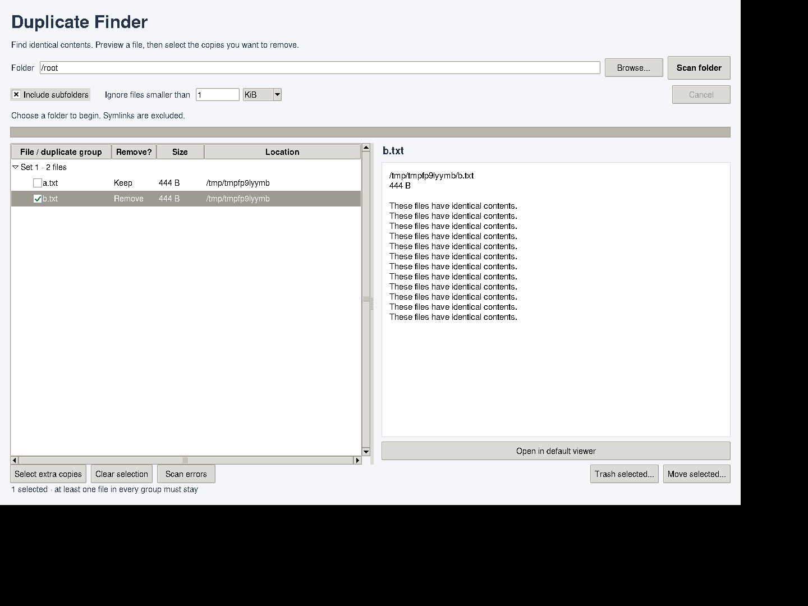

# Duplicate Finder

A small desktop utility by Edwin Combs that finds files with identical contents,
even when their names differ. Version **1.2**.



## Features

- Choose a folder and optionally include subfolders.
- Exclude files below a minimum size in B, KiB, MiB, or GiB.
- Group exact duplicates using file sizes, partial hashes, then full SHA-256 hashes.
- Preview text and images; open audio, video, PDFs and comics in your default viewer.
- Select individual copies using checkboxes or select extra copies in bulk.
- Review exact affected paths and retained copies before moving or trashing files.
- Keep the window responsive with background scanning and cancellation.

## Run the downloadable executable

The Linux x86-64 executable includes Python, Tkinter, Pillow and Send2Trash.
Download it from this project's **Releases** when a release is available.
Make it executable in your file manager's Properties, then launch it.
You can also run it from a terminal:

```bash
chmod +x DuplicateFinder
./DuplicateFinder
```

The prebuilt Linux executable was built on Ubuntu 24.04 with glibc 2.39.
It needs a compatible Linux desktop; it is not a Windows or macOS executable.
If your desktop opens a terminal when launching the executable, use a desktop
launcher with `Terminal=false` rather than the file manager's terminal-run option.

## Run from source

Python **3.10 or newer** and Tkinter are required. Pillow provides image
previews; Send2Trash provides trash support. Moving files works without them.

On Debian/Ubuntu, install Tkinter and virtual-environment support:

```bash
sudo apt install python3-tk python3-venv
```

On Arch/CachyOS, install Python and Tkinter:

```bash
sudo pacman -S python tk
```

From the project folder on Linux/macOS:

```bash
python3 -m venv .venv
. .venv/bin/activate
python -m pip install -r requirements.txt
python DuplicateFinder.py
```

On Windows, use a Python installation with Tcl/Tk support, then:

```powershell
py -m venv .venv
.\.venv\Scripts\Activate.ps1
python -m pip install -r requirements.txt
python DuplicateFinder.py
```

The Linux GUI and executable have been tested. Windows and macOS source paths
are included, but their GUIs and builds have not been verified.

## Using the app

1. Choose the folder, subfolder option and minimum file size; click **Scan folder**.
2. Click a file to preview it.
3. Click its checkbox or its **Remove?** cell to mark it for cleanup.
   **Select extra copies** retains the first path in each group; review that choice.
   Hard-linked names are excluded from automatic selection.
4. Click **Move selected...** to choose a holding folder, or **Trash selected...**.
5. Review the confirmation and apply the action.
6. Review the cleanup report, then rescan before another cleanup.

At least one path in each duplicate group must remain. The app does not offer
permanent deletion. If trash support is absent or fails, it reports the failure
without falling back to permanent deletion.

## Build a single executable

Build on the operating system you want to distribute to. PyInstaller does not
cross-compile a Linux build into a Windows or macOS application.

```bash
python -m pip install -r requirements-build.txt
python build.py
```

The result is `dist/DuplicateFinder` on Linux/macOS or
`dist/DuplicateFinder.exe` on Windows. The build bundles the Python runtime,
Tkinter, Pillow and Send2Trash. Normal operating-system desktop libraries are
still required. One-file builds unpack internally to a temporary directory at
startup, so initial launch can take a few seconds.

Build Linux releases on an older supported distribution to avoid requiring a
newer glibc than users have. Test the built file on the intended target systems.

## Tests

The source includes 22 regression tests using temporary files and mocks:

```bash
python DuplicateFinder.py --self-test
# Equivalent test entry point:
python tests/run_tests.py
```

They cover content matching, size thresholds, subfolders, cancellation,
file changes, keeper protection, trash failure, hard links, symlinks,
destination collisions and copy failures. No real user files are cleaned up.
GUI rendering, checkbox interaction, dialog button visibility and executable
startup were separately checked on a Linux virtual display.

## Limitations

- Matching is byte-for-byte: similar photos, different encodings, or changed
  metadata do not count as duplicates.
- Symlinks are excluded. Hard-linked names are shown individually and labeled;
  removing one name does not necessarily free storage.
- Files are checked for changes before and during hashing and before cleanup.
  A small final filesystem check/action race remains. Avoid concurrent edits
  to the scanned files during cleanup.
- Moves use exclusive destination creation and verified copying before removing
  the source. Metadata is preserved best-effort, but ACLs, extended attributes
  and sparse allocation are not guaranteed.
- Large images may need the external viewer; embedded previews are bounded.
- Cancelling cleanup leaves already completed actions applied. Review the report.

## Project files

- `DuplicateFinder.py` — complete single-file app and embedded tests.
- `requirements.txt` — image-preview and trash dependencies.
- `requirements-build.txt` — dependencies for building the executable.
- `build.py` — executable build script.
- `tests/run_tests.py` — regression-test entry point.
- `docs/screenshot.png` — screenshot for this README.
- `.github/workflows/tests.yml` — runs the regression tests on GitHub pushes and pull requests.
- `CHANGELOG.md`, `LICENSE`, `.gitignore` — project documentation and settings.

## License

Copyright (C) 2026 Edwin Combs.

Licensed under **GNU GPL version 3 or later**. See [LICENSE](LICENSE).
